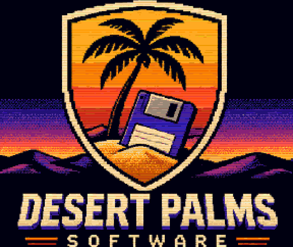
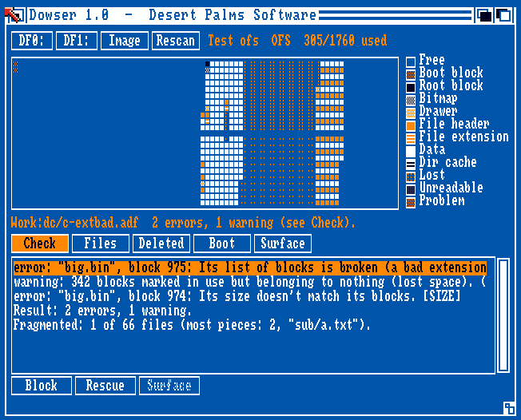
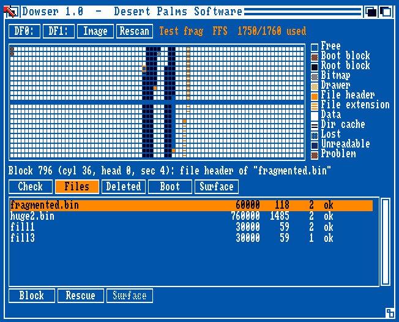
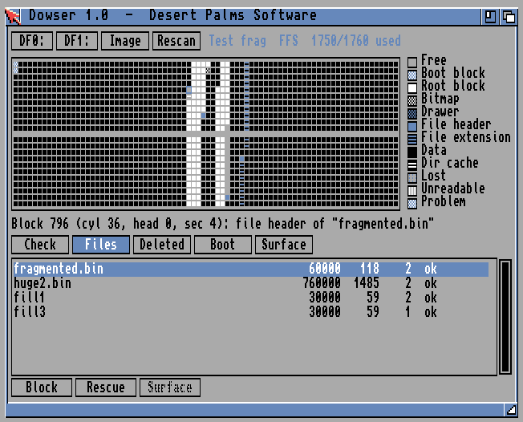
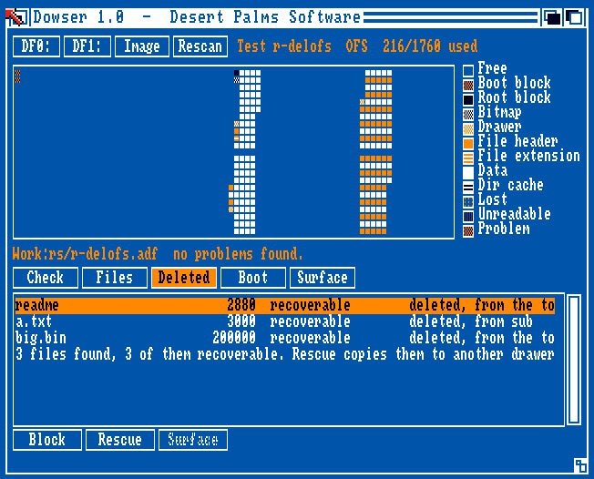
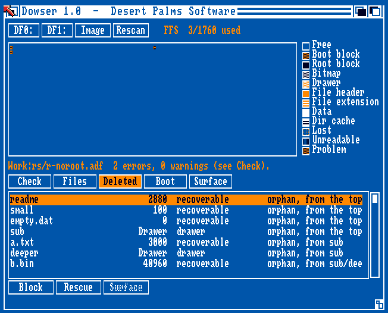
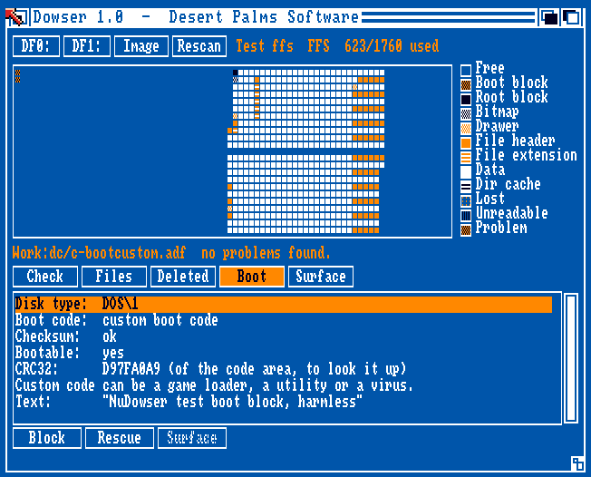
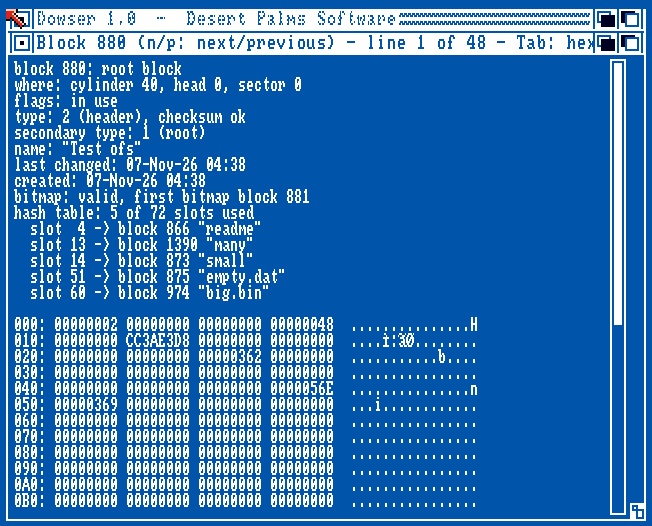
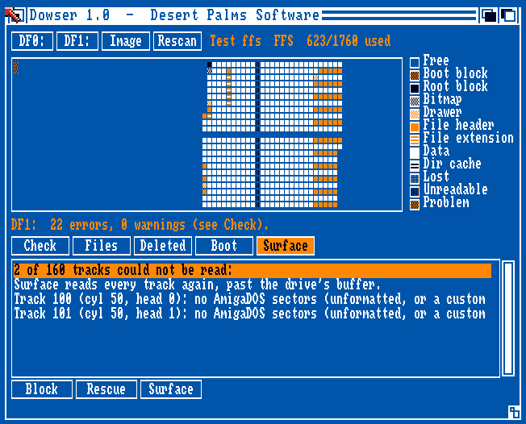

<p align="center">
  
</p>

<h1 align="center">Dowser</h1>

<p align="center">
  <b>A disk inspector and rescue tool for the classic Amiga, Kickstart 1.3 and up.</b><br>
  <i>Dowser finds what's on your disks, and what was lost.</i><br>
  Freeware by Paul Seibert &middot; &copy; 2026 Desert Palms Software
</p>

<p align="center">
  
</p>

<p align="center">
  <a href="https://github.com/PaulSeibert/amiga-dowser/releases/latest"><b>Download Dowser 1.0</b></a> &middot;
  <a href="Dowser.readme">Aminet readme</a>
</p>

---

Dowser looks at a floppy disk, or at an `.adf` disk image, block by block. It draws **a map
of the whole disk** showing where everything is, explains **in plain English** what is wrong
with it, lists the **deleted files** that can still be brought back, and **copies files off
damaged disks**, working around blocks it can't read.

It is written in C against the **AmigaOS 1.3** includes, so it runs on a stock A500 with
512K, and it runs unchanged on AmigaOS 2.x and 3.x. It reads OFS and FFS disks of every kind
(DOS\0 to DOS\5), even on Kickstart 1.3, which can't read FFS floppies itself. It is about
72 KB, needs nothing beyond the ROM, and was tested with automated test disks on Kickstart
1.3 and 3.1.

**Dowser 1.0 is read-only.** It never writes to the disk it is looking at: the module that
reads disks has no write function at all. Rescued files go to another drive or to RAM:.

## Why Dowser

The disk tools of the Kickstart 1.3 era are each good at one thing, and they date from
1988-1991: sector editors, FixDisk, DiskSalv 1, undelete tools. Their successors need
OS 2.04 or 3.x, and today's ADF and boot block inspectors run on the PC. Dowser puts the
block map, the check, the boot block inspector, the surface scan and file recovery in one
program that runs on a stock 1.3 machine, and treats real floppies and `.adf` images
the same way.

## Contents

- [Features](#features)
- [Screenshots](#screenshots)
- [Download and install](#download-and-install)
- [Using Dowser](#using-dowser)
- [Command mode](#command-mode)
- [Known limits](#known-limits)
- [Building from source](#building-from-source)
- [Testing](#testing)
- [Repository layout](#repository-layout)
- [Credits and license](#credits-and-license)

## Features

### The block map

- All 1760 blocks of a DD disk, 80 cylinders by 22 blocks, each drawn by what it is: boot
  block, root, bitmap, drawer, file header, file extension, data, directory cache, free,
  **unreadable**, **lost** (marked in use but used by nothing) and **problem** (used twice,
  or in use but marked free). Pens and fill patterns tell them apart on the four-colour
  Workbench screen, with a legend.
- Click a block and the info line says what it is and whose it is:
  *data block 3 of "Work/readme.txt"*. Select a file and all its blocks light up, so you can
  see how it is spread over the disk.

### Check

A list of findings in plain English, each with its block and file, and a verdict:

- checksum errors, block by block
- the bitmap against what is really used: blocks marked free that are in use (the next file
  written may overwrite them) and blocks marked in use that nothing uses (lost space)
- blocks used twice
- broken hash chains and drawers: pointers off the disk, loops, the wrong kind of block,
  files in the wrong hash slot or with the wrong parent
- OFS data blocks out of order, with the wrong owner or size; file sizes that don't match
  their blocks
- a disk that needs validating; directory caches that disagree with their drawers
- fragmentation, for the disk and for each file

### Files, deleted files and rescue

- **Files**: the whole tree with size, blocks, fragments and a status for each file.
- **Deleted**: files that were deleted but are still on the disk, with the drawer they were
  in, each marked **recoverable** or **partly overwritten** (some of its blocks now belong to
  another file). It also finds **orphans**: files whose drawer, or the whole root block, has
  been lost.
- **Rescue** copies a file, a drawer, the whole disk, a deleted file or all the files found to
  a drawer on another disk, keeping names, dates, protection bits and comments. Found files
  go back into the drawers they came from.
- Blocks that can't be read, or that now belong to another file, come back as zeros, and
  Dowser tells you how many.
- When AmigaDOS calls a disk "not a DOS disk" (a broken boot block, or no root block), Dowser
  rebuilds the tree from the file headers that are left.

### Boot block

- DOS type and flags, checksum, bootable or not.
- Recognises the standard Kickstart 1.x and 2.0+ install code (by the CRC32 of the code area),
  or no boot code at all.
- For **custom code** it shows the readable text in it and its CRC32, so you can look it up.
  It doesn't pretend to name viruses: without a maintained signature list that would be
  guesswork. It says plainly that custom code can be a game loader, a utility or a virus.

### Block viewer and surface scan

- **Block viewer**: any block in hex and ASCII, with its fields decoded for its type (headers,
  OFS data, extensions, directory caches, bitmap, boot block) and pointers turned into names.
  `n` and `p` step to the next and previous block.
- **Surface scan** (drives only): every track read afresh, each one shown as good, damaged, or
  without AmigaDOS sectors (unformatted, or a custom format such as a copy-protected game).
  Unreadable tracks show on the map. Esc stops.

## Screenshots

| Kickstart 1.3 | Kickstart 3.1 |
|---|---|
|  |  |

| Check | Deleted files |
|---|---|
|  |  |

| A disk without its root block | Boot block |
|---|---|
|  |  |

| Block viewer | Surface scan |
|---|---|
|  |  |

## Download and install

Get **Dowser.lha** from the [latest release](https://github.com/PaulSeibert/amiga-dowser/releases/latest)
and unpack it anywhere, for example to `SYS:Utilities`. It contains:

```
Dowser.info              the drawer icon
Dowser/Dowser            the program
Dowser/Dowser.info
Dowser/Dowser.readme     the Aminet readme (opens with More)
Dowser/Dowser.readme.info
```

Dowser needs no libraries, fonts or assigns beyond the ROM. The release also has
**dowser.adf**, a disk that boots straight into Dowser (it holds only Dowser's own files).

## Using Dowser

Start Dowser from Workbench or the CLI, then press a drive button (`DF0:` to `DF3:`, for the
drives you have) or **Image** to open an `.adf` file. The disk is read once, with a progress
bar (Esc stops), and Dowser shows the map and the check. While it reads a floppy, AmigaDOS is
kept off that drive; it gets the drive back afterwards.

- **Check / Files / Deleted / Boot / Surface** switch the list below the map.
- **Block** (or a double-click on the map or the list) opens the block viewer on the selected
  block or file.
- **Rescue** copies the selected file, or everything, to a drawer you choose. On the
  Deleted tab it rescues the selected file or all the files found.
- **Surface** scans a floppy's tracks.
- **Rescan** reads the disk again (after you change it).

From the CLI you can name the disk and the tab straight away:

```
dowser DF0:
dowser Work:Disks/game.adf CHECK
dowser DF1: DELETED
dowser ?                                  ; the usage line
```

## Command mode

`dowser CMD ...` runs Dowser's engine from the CLI or a script, without the window. The test
suites use it, and it is handy for scripts. `dowser CMD` alone lists every command:

```
dowser CMD INFO DF0:                          ; type, name, dates, blocks, files
dowser CMD CHECK Work:Disks/game.adf          ; the findings, in plain English
dowser CMD DELETED DF0:                       ; deleted and orphaned files still there
dowser CMD RESCUE DF0: DELETED ALL TO RAM:found
dowser CMD RESCUE DF1: ALL TO Work:Rescued    ; the whole disk, around any damage
dowser CMD RESCUE DF1: Docs/letter TO RAM:
dowser CMD SCAN DF0:                          ; every track, afresh
dowser CMD BLOCK DF0: 880                     ; one block, decoded
```

The other commands are MAP, FILES, BOOT, REPORT (all the reports from one reading of the
disk) and MEM.

## Known limits

- **880K DD floppies** and their images. HD disks and hard disk partitions are not read.
- **Read-only**: Dowser 1.0 doesn't repair disks or edit blocks. Get your files off first.
- **Damaged tracks are slow** on a real drive, because trackdisk.device retries them. Dowser
  remembers bad tracks, so each is read only once per disk.
- **It was tested in WinUAE only**: Kickstart 1.3 on an A500 (OCS, 512K + 512K) and
  Kickstart 3.1 (ECS, 1MB + 1MB). The damaged floppy was emulated (an extended ADF with
  tracks that have no sectors); it has not yet been tried with a real damaged disk.

## Building from source

You need:

- **Docker**, to run the [`amigadev/crosstools:m68k-amigaos`](https://hub.docker.com/r/amigadev/crosstools)
  image. It provides [bebbo's amiga-gcc](https://github.com/bebbo/amiga-gcc) (GCC 6.5 for
  m68k-amigaos), `xdftool` from [amitools](https://github.com/cnvogelg/amitools), and `lha`.
- **Python 3**, for the tools that turn the ASCII art in `art/` into icons and image data,
  and for the test tools.

```sh
./build.sh       # build/dowser, build/dowser.info
./release.sh     # dist/Dowser.lha, dist/Dowser.readme, dist/dowser.adf
```

The compiler runs with `-mcrt=nix13 -m68000`: libnix startup code for Kickstart 1.3, plain
68000 code, and the 1.3 includes, so nothing newer than 1.3 can be called by accident.

## Testing

No Kickstart ROMs or Workbench files are included. The test disks borrow a few commands
(`Echo`, `FailAt`, ...) from **your own** Workbench 1.3 disk image, given in `WB13_ADF`.
Each script makes test images, and a boot disk that runs `dowser CMD` steps on them and on
the emulator's drives and writes the results to a host folder mounted as `Work:`. A Python
checker then compares them on the PC with **`tools/adfmodel.py`**, an independent reader of
OFS and FFS images written for the tests (itself checked against `xdftool`).

| Script | Checker | What it checks |
|---|---|---|
| `testmodel.sh` | `tools/checkmodel.py` | the map, files, fragments and blocks of OFS, FFS, international and directory-cache images, full, fragmented and blank disks, from `.adf` files and through emulated drives (writable, write-protected, empty) |
| `testcheck.sh` | `tools/checkcheck.py` | images damaged in known ways (checksums, bitmap, chains, extensions, sizes, directory caches, boot blocks): each finding must appear, and nothing on clean disks |
| `testrescue.sh` | `tools/checkrescue.py` | undeleting on OFS and FFS, partly overwritten files, a disk without a root block, a disk without a boot block, a destroyed data block, an emulated damaged floppy with unreadable tracks (surface scan and rescue), refusals; rescued files byte for byte |
| `testgui.sh "ARGS"` | (screenshots) | a boot disk that starts the window with the given arguments |

Every suite passes on Kickstart 1.3 and 3.1. Every image and drive is hashed before and after
each run and must be unchanged, and no memory is lost on a second round.

## Repository layout

```
src/            C sources (disk, fs, check, boot, recover, scan, blockview, ui, cmd, ...)
art/            icons and logo as ASCII art (one character per pixel)
tools/          icon and image converters, test image makers, the reference reader, checkers
docs/DEVELOPMENT.md  design rules, the disk format as used, Kickstart 1.3 lessons, the tests
docs/media/     screenshots and animation
Dowser.readme   Aminet readme (shipped in the archive)
build.sh        build the program and its icon
release.sh      build the release archive and boot disk
test*.sh        the test disks described above
```

## Credits and license

**Dowser** was written by **Paul Seibert**, © 2026 **Desert Palms Software**. It is the
partner of [Oasis](https://github.com/PaulSeibert/amiga-oasis), the two-pane file manager,
and [SysMon](https://github.com/PaulSeibert/amiga-sysmon).

Dowser is **freeware**. See [LICENSE](LICENSE) for the terms. In short: free to use and to
copy unchanged, including on Aminet, cover disks and collections; no warranty.

Built with [bebbo's amiga-gcc](https://github.com/bebbo/amiga-gcc) and libnix,
[amitools](https://github.com/cnvogelg/amitools) and LHa for UNIX, and tested in
[WinUAE](https://www.winuae.net/). Amiga is a trademark of its respective owner.

<p align="center">
  <br>
  <b>Desert Palms Software</b>: new software for classic Amiga computers.
</p>
